# Awesome-Film-Production-Open-Cinematography

  

  

  

  

  

  

# 🎬 Top Film Production & Open Cinematography

**Curated List of SaaS/Commercial Platforms & Open-Source GitHub Projects**  

*Focused on Cloud Camera-to-Cloud Review, Non-Linear Video Editing (NLE), Open Color Management (OCIO), VFX Production Tracking & Open-Source Cinema Cameras*  

**Last updated: November 2026**

This repository tracks notable **SaaS/Commercial platforms** and **open-source projects** for **Film Production & Open Cinematography**. These tools power Camera-to-Cloud dailies review, color grading and Academy ACES/OpenColorIO pipelines, VFX shot management, open-source cinema camera firmware (`Magic Lantern`, `AXIOM`), non-linear video editing (`Kdenlive`, `Shotcut`, `Olive`, `Blender VSE`), and self-hosted media asset management for filmmakers, cinematographers, post-production houses, and VFX supervisors.

**Examples** include Frame.io (Adobe), ShotGrid / Flow Production Tracking (Autodesk), Sony Ci Media Cloud, Blackmagic Cloud, DaVinci Resolve Studio, Vimeo Review, Iconik (Backlight), ftrack Studio (Backlight), LucidLink, and Shade.inc (the category leaders).

**🚀 Open-source emphasis**: This section is heavily expanded with every major active project for open cinematography and cinema camera firmware (`openfilm/openfilm`, `Magic Lantern`, `apertus° AXIOM`, `CinePi`), Academy Software Foundation (ASWF) color/image standards (`OpenColorIO`, `OpenEXR`, `OpenTimelineIO`), open-source NLEs (`Blender`, `Kdenlive`, `Shotcut`, `OpenShot`, `Olive`), and self-hosted VFX production trackers & dailies review (`Kitsu / Zou`, `OpenRV`, `MediaCMS`) — ideal for independent filmmakers, post-production engineers, and studios eliminating per-seat SaaS lock-in.

🤝 Contributions welcome! Open a PR to add/update entries. Keep descriptions factual and link to official sites.

## 📑 Table of Contents

- [📊 Sector Overview & Market Dynamics](#-sector-overview--market-dynamics)

- [☁️ SaaS/Hosted & Commercial Platforms](#️-saashosted--commercial-platforms)

- [💻 Open-Source GitHub Projects](#-open-source-github-projects)

- [🛠️ How to Contribute](#️-how-to-contribute)

- [⚠️ Disclaimer](#️-disclaimer)

- [💖 Support & Thank You](#-support--thank-you)

## 📊 Sector Overview & Market Dynamics

The global Film Production, Post-Production & Media Asset Management Software market is valued at approximately **$14.5B–$18.0B+ in 2026**, expanding at a ~11%–15% CAGR driven by Camera-to-Cloud workflows, virtual production, and AI-assisted media indexing. The commercial post-production and cloud review layer exhibits **strong winner-take-most consolidation** around Adobe (Frame.io), Autodesk (Flow/ShotGrid), Blackmagic Design, and Sony, while the underlying color-science, interchange, and production-tracking infrastructure is **heavily standardized on Academy Software Foundation (ASWF) and open-source tools** (`OpenColorIO`, `OpenEXR`, `OpenTimelineIO`, `Blender`, `Kitsu`, `FFmpeg`).

## ☁️ SaaS/Hosted & Commercial Platforms

*Sorted descending by company valuation / annual revenue scale.*

| Platform | Description | Company Scale (Valuation / Revenue) | Starting Paid Tier | Free Tier / Trial Limit |

| :--- | :--- | :--- | :--- | :--- |

| **[Frame.io (Adobe)](https://frame.io)** | Cloud-native video review, Camera-to-Cloud (C2C) dailies ingestion, and frame-accurate collaborative annotation platform integrated with Premiere Pro and Resolve. | **Part of Adobe Inc.** (Acquired for $1.275B; ~$21.5B+ Adobe annual revenue) | **$15 / user / month** billed annually ($19/mo monthly for Pro; included in Creative Cloud) | **Forever Free Plan** (Up to **2 members**, 2 projects, **2 GB cloud storage**, and Camera-to-Cloud integrations) |

| **[Autodesk Flow Production Tracking (formerly ShotGrid)](https://autodesk.com)** | Industry-standard cloud production management, VFX shot tracking, dailies review, and resource scheduling platform for film and animation studios. | **Part of Autodesk Inc.** (~$6.1B+ annual revenue; ~$60B+ market cap) | **$30 / user / month** billed annually ($40/mo monthly; ~$280/yr per seat) | **30-Day Full-Access Free Trial** (Includes full VFX/animation shot tracking, review playlists, and API access; free educational licenses for students/schools) |

| **[Sony Ci Media Cloud](https://cimediacloud.com)** | Enterprise cloud media workspace for camera-to-cloud dailies, frame-accurate review, rough-cut assembly, and global broadcast distribution. | **Part of Sony Group Corp.** (~$88B+ annual revenue; ~$110B+ market cap) | **$25 / month** for Solo tier (500 GB storage) or **$100 / month** Team (2 TB + 5 seats) | **Forever Free Personal Tier** (**5 GB active cloud storage**, frame-accurate review links, and file transfers for 1 user) |

| **[Blackmagic Cloud](https://blackmagicdesign.com)** | Real-time cloud project server, global media sync, and Blackmagic Proxy Generator workflow enabling multi-user DaVinci Resolve editing and grading. | **~$500M–$800M+ Est. Revenue** (Privately held Australian cinema & broadcast giant) | **$5 / month** per Project Library + **$15 / month** starting Cloud Storage (500 GB) | **Forever Free Cloud Account & Presentation Preview** (Free Blackmagic Cloud ID, camera-to-cloud proxy upload testing, and free DaVinci Resolve base app) |

| **[DaVinci Resolve Studio (Blackmagic Design)](https://blackmagicdesign.com)** | Hollywood's flagship color grading, non-linear editing (NLE), Fusion VFX, and Fairlight audio post-production suite with Neural Engine AI tools. | **~$500M–$800M+ Est. Revenue** (Privately held; bundled with Blackmagic Cinema Cameras) | **$295 one-time perpetual license** (No recurring subscription; includes free lifetime updates) | **Forever Free DaVinci Resolve Base Edition** (100% free unrestricted 4K/60fps NLE, color grading, Fusion VFX, and Fairlight audio for commercial/personal use) |

| **[Vimeo Review (Vimeo Enterprise / Standard)](https://vimeo.com)** | Cloud video hosting and time-coded collaborative review platform allowing directors and clients to leave frame-specific notes and version comparisons. | **~$415M+ Annual Revenue** (~$800M–$1.1B public market cap on NASDAQ) | **$12 / month** billed annually (Starter) or **$20 / month** Standard (unlocks Review tools) | **Forever Free Basic Plan** (Up to **1 GB total storage / 2 videos per month** with basic player; 7-day trial on Review-enabled plans) |

| **[Iconik (Backlight)](https://iconik.io)** | Hybrid-cloud Media Asset Management (MAM) platform indexing on-premise SAN/NAS storage and cloud buckets with AI tagging and frame-accurate review. | **Part of Backlight** (~$100M+ Backlight group revenue; backed by PSG Equity) | **$10 / user / month** (Browse user) or **$25 / user / month** (Pro user) + storage/proxy usage | **14-Day Free Trial** (Includes **$100 in free cloud credits** to test hybrid storage indexing, AI transcription, and collaborative review) |

| **[ftrack Studio (Backlight)](https://ftrack.com)** | Cloud-based creative project management, production tracking, and synchronized cineSync media review platform for film, VFX, and commercial studios. | **Part of Backlight** (Acquired by Backlight; ~$100M+ parent group revenue) | **$25 / user / month** billed annually ($30/mo monthly for ftrack Studio) | **14-Day Full-Access Free Trial** (Unlimited projects, task boards, Gantt timelines, and synchronized review sessions during evaluation) |

| **[LucidLink](https://lucidlink.com)** | Cloud-native streaming filespace enabling remote editors and colorists to mount massive RAW/ProRes camera media directly from object storage as a local drive. | **~$200M–$350M Est. Valuation** (~$30M–$50M est. ARR; $90M+ VC funding) | **$20 / month** per TB for Basic cloud storage (Team plans from **$100/mo** for 5 users + 5 TB) | **14-Day Full-Access Free Trial** (Includes **1 TB of high-speed cloud filespace** for up to 5 users with no credit card required) |

| **[Shade.inc](https://shade.inc)** | AI-powered creative asset management and smart drive combining natural-language visual search, automatic metadata tagging, and instant cloud streaming. | **~$25M–$50M Est. Valuation** (Venture-backed creative AI startup) | **$15 / user / month** billed annually ($20/mo monthly for Pro) + storage tiers | **Forever Free Starter Plan** (Up to **20 GB cloud storage**, AI visual/audio semantic search, and shareable review links for individuals) |

## 💻 Open-Source GitHub Projects

| Project | License / Hosting Cost | Free Tier / Self-Hosted Limit | Description |

| :--- | :--- | :--- | :--- |
